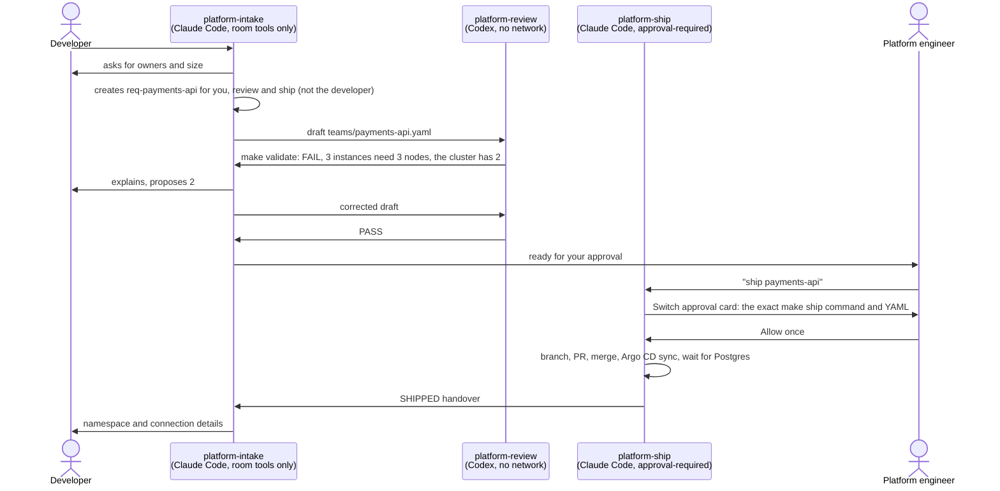

# Platform Desk

A developer asks for a namespace and a Postgres database in team chat. Three agents
handle the request in [Switch](https://docs.switchagents.ai) rooms:
- one talks to the developer and drafts the request;
- one checks it against the platform's policy;
- one ships it.

The platform engineer approves the one step that changes anything, with one click.

What comes out is a merged pull request adding `teams/<team>.yaml`, a namespace with
guardrails, a running two-instance Postgres, and a handover message in the chat.

Built for WeMakeDevs' [Flip the Switch](https://www.wemakedevs.org/hackathons/switch)
hackathon, Track 01 (business workflow).



## How it uses Switch

[`switch/platform-desk.template.yaml`](switch/platform-desk.template.yaml) is the
whole setup: three agents, the `platform-requests` room and its kickoff. Import it in
Switch Console and every limit below comes with it.

| Agent | Runs on | Who can address it | What it can do |
|---|---|---|---|
| `platform-intake` | Claude Code | anyone in the room | Only Switch's room tools: ask, draft, create and link rooms. No files, no shell, no web. |
| `platform-review` | Codex (Claude Code if Codex isn't installed) | you and your agents | Run `make validate` in its own clone. Codex's sandbox has no network. |
| `platform-ship` | Claude Code, `auto_mode: false`, `auto_approve: false` | you only | Run `make ship`, and only after you click Allow on its card. |

- **Two rooms, kept apart on purpose.**
  - Developers talk to intake in `platform-requests`, each in their own thread.
  - For each request, intake creates `req-<team>` with `create_room`, with you,
    review and ship, and links it back. The draft, the review, the approval, the
    PR and the handover stay there.
  - The developer isn't in that room, and review and ship aren't in
    `platform-requests`. The agents that can run commands never read what a
    developer writes, only the YAML intake drafted, and the validator rejects any
    key it doesn't know.
- **Two vendors check each other.** Claude Code drafts and Codex reviews, by
  @-mention in the room.
- **The approval is a Switch permission card.** Ship runs approval-required, so its
  one command waits on an Allow / Decline card that shows the full command and YAML.
  Switch records who answered. Only the people ship takes orders from can answer, and
  that's you alone. When the developer told ship to ship, Switch answered before
  the model saw it: *"I only take instructions from my owner."*
- **One card per request.** All of ship's work is one command:
  `make ship TEAM=<team>` with the reviewed YAML in a heredoc. It
  1. validates the YAML again;
  2. opens the PR, with the room, the review result and the approver in its body;
  3. merges it;
  4. makes Argo CD refresh at once;
  5. waits for the namespace and Postgres;
  6. prints the handover.

  It never prints the password, only where to read it.

**Without Switch,** the developer has nobody to answer their follow-up questions, the
reviewer can't hand its verdict back to the drafter, and the approval has nowhere to
live. A webhook could run `make ship`, but it can't hold the conversation, or the
separation between who drafts, who checks and who approves.

### What each agent can reach, and what I found

The limits are set by the tools, not by the instructions. Testing in Switch found
three holes in my first version; [BUILDLOG.md](BUILDLOG.md) has the details.

- **Claude Code's Read works on the whole disk.** The first intake had
  `tools: Read, Grep, Glob`, no shell, and still read `~/.config/gh/hosts.yml` when
  asked. An agent anyone can talk to could have posted a kubeconfig to the room.
- **Switch's `send_attachment` uploads any local file by path**, so removing Read
  alone isn't enough.
- **`update_agent_detail` changes who may address another agent** without any
  special capability. Through intake, a requester could have made ship take orders
  from anyone, and then approved ship's command themselves.

Now intake's `tools` is `[mcp__switch]`, and its `disallowedTools` takes out the
attachment tools and the ones that change agents, run templates or edit roles. Its
session's tool list confirms it: no Read, Grep, Glob or Bash, and 43 of Switch's 59
tools.

Ship's GitHub token is fine-grained and only works on this repo. On macOS it lives in
the login keychain. Inside Codex's sandbox, reading a file worked, but a keychain
lookup found nothing and the network was blocked.

That isn't a wall, though. Codex can ask to leave its sandbox, and in the auto mode
Switch runs it in, Codex's own automatic reviewer answers, not you. I asked the
reviewer to read a dummy keychain item. It asked to leave the sandbox, the request
was approved, and it printed the value. So I took the developers out of its room.
The only other choice Switch Console offers for Codex is approval-required, where
every command and every tool call waits for you.

**Honest limits:**
- All three agents run as your user on one machine. The boundaries are Claude Code's
  tool list and Codex's sandbox, not separate OS users.
- Treat the reviewer as able to read anything your user can. Codex's automatic
  reviewer let it out of the sandbox for a keychain read, and it still has Switch's
  attachment tool. Developers can't address it and aren't in its room, but the draft
  it reviews still carries their values, through intake.
- With the Claude Code fallback, the reviewer has no sandbox, only Claude Code's
  auto-mode review.
- Ship's token can merge any PR in this repo. What stops it is the card.
- On the card, click **Allow once**. "Allow for this session" can let later commands
  run without asking.
- On the local cluster there are no backups. On GKE, WAL and daily base backups go to
  the team's bucket.

## Run it

You need macOS or Linux, Docker, `kind`, `helm`, `kubectl`, `yq` and `gh` (signed
in), [Switch Console](https://docs.switchagents.ai) 0.40.1 or later with its local
server running, and Claude Code signed in. Codex is optional.

1. **Fork and point Argo CD at your fork.** Argo CD deploys from GitHub, so it has
   to read your fork, not this repo.
   ```sh
   git clone https://github.com/<you>/platform-desk && cd platform-desk
   make use-repo REPO=https://github.com/<you>/platform-desk
   git commit -am "Point Argo CD at my fork" && git push
   ```
2. **Start the cluster.** This brings up kind with 1 control plane and 2 workers,
   Argo CD, cert-manager and CloudNativePG, in about two minutes.
   ```sh
   make local-up
   ```
3. **Give ship a token.** Create a
   [fine-grained token](https://github.com/settings/personal-access-tokens/new) for
   your fork only, with Contents and Pull requests set to read and write. On macOS:
   ```sh
   security add-generic-password -s platform-desk-ship -a "$USER" -w   # prompts for the token
   ```
   On Linux, save it to `~/.config/platform-desk/ship-token` (mode 600).
4. **Import the template.** In Switch Console, go to Templates → Import template,
   pick `switch/platform-desk.template.yaml`, and click Use. Set `repo` to your fork.
5. **Give review and ship their clones.**
   ```sh
   make agents-clone
   ```
6. **Ask for a database.** In Mattermost, as your own account rather than the admin,
   post in `platform-requests`:
   > @platform-intake we need a namespace and Postgres for payments-api, 3 instances for HA

   When ship's card shows up, it's in a thread. Open the thread, read the command,
   and click **Allow once**.

`make test` runs the validator's own tests. `make local-down` deletes the cluster.

## Measured

<!-- Filled in from the final clean run. -->

**First request shipped by the agents, `inventory-api` (5 November):**
- Run time: 52 seconds from Allow to a ready database.
  - push 2 s, merge 8 s, Argo CD app created 10 s, synced 11 s, Postgres 2/2 ready
    52 s.
  - Primary and replica landed on different workers.
- Human actions: the developer's two messages, then my order and one click on the
  card.
- Review findings: the first draft failed for 2 reasons, the second passed.
- [PR #2](https://github.com/IstvanCsVarga/platform-desk/pull/2) names the request
  room, the review result and the approver.

So far, from the runs on 4 November:
- **Codex's first review:** it saved the draft, ran `make validate`, posted the
  result and handed it back to intake in 32 seconds.
- **The 3-instance request:** the review failed it for both real reasons. A third
  instance needs a third node, so it can never schedule here; on the cluster, it
  stayed Pending with "didn't match pod anti-affinity rules". And 3 × 5Gi doesn't fit
  a 10Gi quota.
- **`make ship` from the terminal:** for `orders-api` with 2 Postgres instances, it
  went from push to a ready database in 52 seconds.

## What existed before, and what was built during the event

- **Before 3 November:** the platform, my `gke-platform` project. That's Terraform
  for GKE, Argo CD with an ApplicationSet per team file, the team chart (namespace,
  quota, Pod Security, NetworkPolicy, CloudNativePG), and the local kind mode. Its
  history is in this repo up to `9403735`, and
  [docs/PLATFORM.md](docs/PLATFORM.md) is its write-up.
- **During the event:**
  - [everything after `9403735`](https://github.com/IstvanCsVarga/platform-desk/compare/9403735...main):
    the Switch template;
  - `POLICY.md` and `policy.yaml`;
  - `make validate` and its tests;
  - `make ship`;
  - `make agents-clone`;
  - [BUILDLOG.md](BUILDLOG.md).

Built with Claude Code, with most prompts dictated in Wispr Flow. Codex is one of the
agents.

## Layout

```
switch/                the Switch template: agents, room, kickoff
POLICY.md, policy.yaml the rules a request must meet, and their numbers
scripts/               validate-team.sh (make validate), ship-team.sh (make ship), the validator's tests
tests/validate/        team files that must pass, and ones that must fail for a named reason
teams/                 one YAML per team: the input to everything
gitops/                Argo CD: root app, platform apps, teams ApplicationSet, the team chart
terraform/             the GKE path (see docs/PLATFORM.md)
local/                 kind cluster config and cluster secret for make local-up
```
