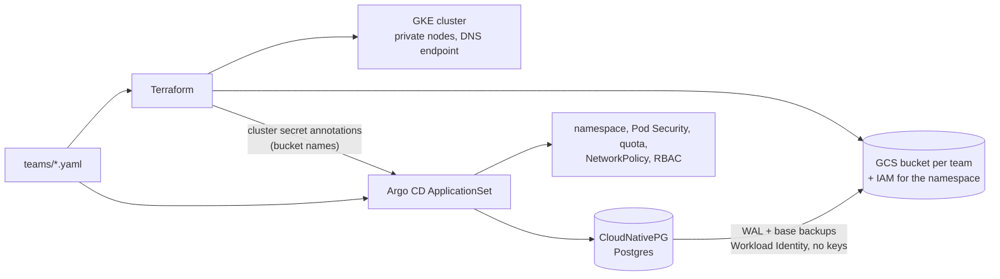

# The platform underneath

This is the `gke-platform` write-up, from before the hackathon. Platform Desk adds
the Switch agents on top; see the [README](../README.md).

A small self-service platform on Google Cloud (GKE): a product team gets a namespace,
cloud permissions and a backed-up Postgres database from one YAML file.

I built it in October 2026 to get hands-on with GCP, next to the AKS platforms I
run at work. It's deliberately small: one zonal cluster, two example teams.

```yaml
# teams/<team>.yaml — the file name is the team name and the namespace
team: voice-api
owners: [alice@example.com]
quota: { cpu: "4", memory: 8Gi, storage: 50Gi }
postgres: { enabled: true, instances: 2, storage: 5Gi }
```

From that file:

- **Terraform** (`make apply`) validates it, creates the team's GCS backup bucket,
  grants the team's namespace access to it through Workload Identity Federation, and
  lets the owners reach the cluster. It then publishes the bucket name to Argo CD.
- **Argo CD** creates the namespace with Pod Security, a quota, default requests, a
  namespace-local NetworkPolicy and an `edit` RoleBinding for the owners. It also
  creates a CloudNativePG cluster that archives WAL and daily base backups to the
  bucket. Until Terraform has run, the team's Postgres doesn't render at all, rather
  than archiving to a bucket that doesn't exist.

There are no service account keys, and no project IDs or bucket names in Git.



## Design decisions

**One file, two control planes.** Terraform owns cloud resources and Argo CD owns
in-cluster resources; `teams/*.yaml` is the contract both read, keyed by file name
on both sides. Terraform rejects a file at plan time if:

- the `team` field doesn't match the file name;
- the name collides with a system or platform namespace (`kube-*`, `argocd`, …), or
  wouldn't fit in a bucket name;
- `owners` isn't a list of emails.

The `teams` AppProject denies the same namespaces, in case a file reaches Argo CD
first.

**Terraform hands values to Argo CD through the cluster secret** (the GitOps Bridge
pattern). `make apply` writes Terraform outputs as annotations on Argo CD's cluster
secret, and the teams ApplicationSet reads them back. There is no Terraform
`kubernetes` provider pointed at a cluster it is still creating.

**IAM instead of network allowlists.** The control plane has no IP endpoint at all.
`kubectl` goes through the [DNS-based endpoint](https://cloud.google.com/kubernetes-engine/docs/concepts/network-isolation),
authorised by `container.clusters.connect`. Nodes are private and reach the
internet through Cloud NAT. They run as a dedicated service account with
`roles/container.defaultNodeServiceAccount`, never the Compute Engine default
(Editor).

**Workload Identity Federation with direct principals.** The backup bucket grants
`principalSet://…/namespace/<team>`: the Kubernetes identities in the team's
namespace, with no Google service account, annotation or key in between.

- The namespace is the trust boundary. Anything that runs there, including a
  restore-drill cluster, can use the team's backups. Anyone with `edit` there can
  delete them, which is why the bucket has 7 days of soft delete.
- That identity is the same in every cluster of the project, so this assumes one
  cluster per project.
- `roles/storage.legacyBucketReader` is there because barman-cloud calls
  `storage.buckets.get` before archiving, which `objectUser` doesn't include.

**Postgres via CloudNativePG and the Barman Cloud plugin.**

- The in-tree `barmanObjectStore` is deprecated as of CNPG 1.26, so backups use the
  plugin (`ObjectStore` + `method: plugin`).
- WAL is archived continuously: an RPO of at most `archive_timeout`, 5 minutes by
  default.
- Retention (`7d`) is barman's job. There's no bucket lifecycle rule that could
  delete a base backup the WAL chain still needs.
- With two instances, the replica must sit on another node, so one spot preemption
  can't take out both. Replication is asynchronous.
- Argo CD is told never to delete or prune the `Cluster` or its `ObjectStore`, so
  removing or renaming a team file can't drop a database.

**Guardrails per team namespace.**

- Pod Security `baseline` is enforced, with `restricted` as a warning. GKE Standard
  enforces nothing by default, and without it `edit` is enough to run a privileged
  pod and take over the node.
- A `ResourceQuota` caps requests, and allows no LoadBalancers or NodePorts. A
  `LimitRange` gives pods without requests a default, so the quota doesn't reject
  them.
- The NetworkPolicy keeps ingress namespace-local by default, enforced by Dataplane
  V2. It's a default, not a wall: owners can add policies.

**Cost.**

- Zonal cluster, so the GKE free tier covers the management fee.
- Spot `e2-standard-4` nodes autoscaling 1–3, with 50 GB disks.
- GKE cost allocation is on: with the detailed billing export to BigQuery, spend
  breaks down by namespace, i.e. by team.
- `-var gpu_pool=true` adds an L4 spot pool that scales from zero and is tainted for
  GPU workloads only. It needs GPU quota, which a new project doesn't have, so it
  wasn't exercised here.

**Flat Terraform, no modules.** One environment, one root module. I'd extract modules
when a second environment shows what actually varies.

## Run it

Needs `gcloud` (with `gke-gcloud-auth-plugin`), `terraform`, `helm`, `kubectl`, and a
project with billing. Argo CD reads `gitops/` and `teams/` from this repo on GitHub.
In a fork, run `make use-repo REPO=https://github.com/<you>/gke-platform` and push
before `make bootstrap` or `make local-up`.

```sh
PROJECT=my-project
gcloud storage buckets create gs://$PROJECT-tfstate --project=$PROJECT --location=europe-west4 \
  --uniform-bucket-level-access --public-access-prevention
gcloud storage buckets update gs://$PROJECT-tfstate --versioning

make init apply PROJECT=$PROJECT   # network, cluster, node pools, team buckets and IAM
make bootstrap PROJECT=$PROJECT    # Argo CD, cluster secret, root app; Git takes over from here
make argocd-ui                     # admin password, then https://localhost:8080
make destroy PROJECT=$PROJECT      # team namespaces (and their disks) first, then terraform destroy
```

Every `kubectl` and `helm` call in the Makefile names the cluster's context
explicitly, so a stray current context can't receive anything.

`make destroy` deletes the team namespaces and waits for their persistent volumes to
go before running `terraform destroy`. If any volume is left, it stops. Deleting the
cluster first would orphan the persistent disks, and they would keep billing.

### Locally, on kind

`make local-up` runs the same Argo CD values, root app and team files on a kind
cluster, with no GCP project. Needs Docker, `kind`, `helm` and `kubectl`.

```sh
make local-up     # kind cluster (1 control plane, 2 workers), Argo CD, local cluster secret, root app
make local-ui     # admin password, then https://localhost:8080
make local-down   # deletes the kind cluster
```

What's different from GKE:

- **No backups.** There's no Terraform, so there's no bucket.
  `local/cluster-secret.yaml` sets `gke-platform/pg-backups: disabled`, and the team
  chart then leaves out the `ObjectStore`, WAL archiving and the `ScheduledBackup`.
  On GKE nothing sets it, so a missing bucket still stops a team's Postgres from
  rendering.
- **Owners have no effect.** Their `edit` RoleBindings render, but kind has no
  Google accounts.
- **Argo CD still reads `main` on GitHub**, so a change reaches the local cluster
  once it's merged. In a fork, run `make use-repo` first (see above), or your
  cluster follows this repo instead of yours.

## Verified

Deployed once into a new project on 22 October 2026, checked, and torn down the same
evening.

- `terraform apply`: 19 resources in 13 minutes, 10½ of them the GKE control plane.
- `make bootstrap`: all six Argo CD applications Synced and Healthy 5 minutes later.
  Nothing was applied by hand after `root`.


On the running cluster:

- **Backups.** The first base backup was in GCS a minute after the database started.
  `kubectl cnpg status` showed WAL archiving OK with nothing waiting, and the replica
  streaming from a second node. The autoscaler added that node for the required
  anti-affinity.
- **Restore drill.** I wrote 10,000 rows after that base backup, switched WAL, and
  bootstrapped a new `Cluster` from the bucket alone. Row count, sum and an md5 over
  every row matched the source. The table didn't exist at the base backup, so every
  row came from WAL replay. The restore took 92 seconds.
- **No keys.** The bucket's only team grants are to the namespace `principalSet`. No
  service account in the project has a user-managed key, and the team namespace
  holds only the certificates and passwords CNPG generates.
- **Guardrails, tested from `evals`.**
  - `pg_isready` against `pg-rw.voice-api:5432` got no response; from `voice-api`
    itself it was accepting connections.
  - A privileged pod was rejected by Pod Security `baseline`.
  - A `LoadBalancer` Service was rejected by the quota.
- **Cluster.** The control plane has no IP endpoint. Nodes are private spot Shielded VMs
  with secure boot, run as `gke-nodes`, and give pods the GKE metadata server.
- **Teardown.** `make destroy` deleted the team namespaces and their disks, then all 19
  Terraform resources, in 10½ minutes. Afterwards the project had no instances, disks,
  snapshots, IPs, load balancers, networks or clusters, only the Terraform state
  bucket. From `apply` to the end of `destroy` took 40 minutes.


**Locally, on kind** (2 November 2026):

- `make local-up` took 65 seconds. The platform apps and `team-evals` were Synced
  and Healthy 55 seconds later.
- `team-voice-api` came up with both Postgres instances on separate workers and the
  replica streaming, with no `ObjectStore` or `ScheduledBackup`.
- kindnet enforces the NetworkPolicy: from `evals`, a connection to another team's
  Postgres was refused, and from that team's own namespace it connected.

### What broke, or surprised me

- **`kubectl cnpg status` couldn't reach the instances.** On GKE the API server reaches
  pods through the `konnectivity-agent` pods in `kube-system`, and the namespace-local
  NetworkPolicy dropped those calls to the status port. Fixed by allowing just those
  pods, on just port 8000 (`4263744`).
- **My first restore drill came back without the test table, and the restore was
  right.** I'd run the inserts and `pg_switch_wal()` in one `psql -c`, which is one
  transaction, so the commit landed in a WAL segment that wasn't archived yet. That's
  the RPO in practice: commits since the last archived segment are lost until
  `archive_timeout` ships them.
- **Sync waves opened early.** Argo CD gates a wave on the health of its Applications,
  and a newly created Application reports Healthy before its first sync. So the Barman
  plugin's app was created while cert-manager, which it needs, was still syncing. It
  converged anyway, and the per-app retries make that safe. A health check that only
  reports Healthy once Synced would make the waves mean what they say.

## Known limits

- **Adding a team takes two steps.** Merge the file, then run `make apply`. In
  production, a CI pipeline would run the plan on the PR and the apply on merge.
- **Recreating a team's `Cluster` against a bucket that still holds its old WAL
  stops archiving.** Barman's empty-archive check refuses to overwrite it. A rebuilt
  cluster needs a new `serverName` or a restore from that archive.
- Owners are individual Google accounts, not Google groups.

## What I'd change for production

- **Cluster:** regional, with an on-demand node pool for system workloads. Spot only
  for workloads that tolerate preemption.
- **CI:** `terraform plan` on PRs and apply on merge, via GitHub Actions with keyless
  Workload Identity Federation. Add `teamctl`, a small Go validator, so a team file
  is checked before review rather than at plan time. Add CODEOWNERS on `teams/`.
- **Argo CD:** SSO through Google groups, Argo CD managing itself, and a per-team
  `AppProject` so teams deploy their own apps into their own namespace only.
- **Postgres:** a PgBouncer `Pooler`, CNPG metrics through `PodMonitoring` for Google
  Cloud Managed Service for Prometheus, alerts on WAL archiving failures, and
  scheduled restore drills.
- **Policy:** Policy Controller or Kyverno for image provenance, on top of Pod
  Security.

## Layout

```
teams/                 one YAML per team: the input to everything
terraform/             VPC, NAT, GKE, node pools, team contract checks, buckets, IAM
gitops/bootstrap/      Argo CD Helm values and the root Application
gitops/platform/       AppProjects, cert-manager, CloudNativePG, Barman Cloud plugin, teams ApplicationSet
gitops/charts/team/    what a team gets in its namespace
local/                 kind cluster config and cluster secret for make local-up
docs/                  screenshots from the deploy run
```
